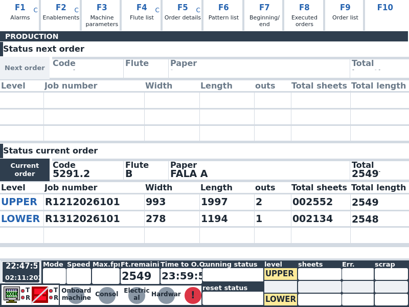
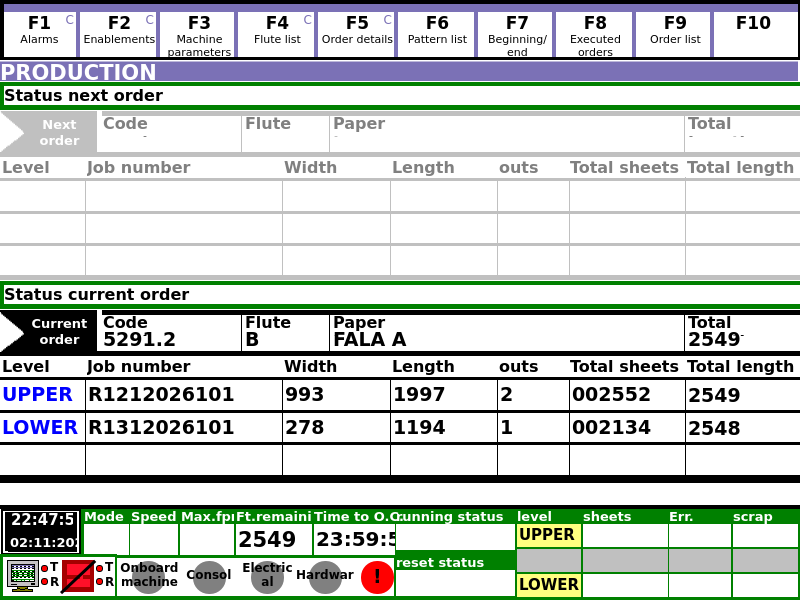
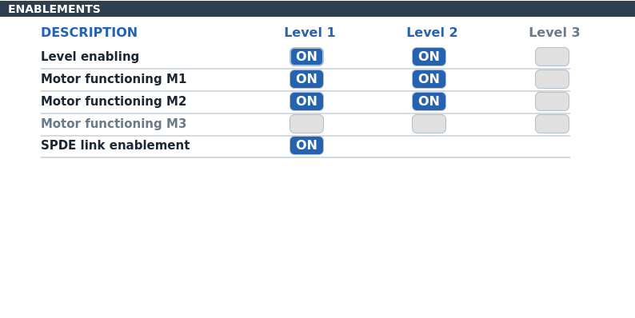

# syncrojs

Tools for running a Fosber corrugator line: a web application for planning and watching production, and the controller programs that sit next to the machine.

## What is here

| Path | What it is |
|---|---|
| `app.js`, `routes/`, `models/`, `utils/`, `client/`, `public/` | Web application: Node.js and Express with a React client and PostgreSQL. Orders, materials, shifts, and a live dashboard fed by Syncro. |
| `SyncroC/`, `SyncroS/` | Sources of the Syncro programs (C# and C++). The web application talks to the Syncro server over TCP. |
| `stag/` | The original STAG cut-off controller, written in Visual Basic 6, with data from the machine. |
| `stag-qt/` | Port of STAG to Qt 6, so that it runs on Linux. Current work is on the `stag-qt-port` branch. |
| `tools/` | Order generator and planner formats, the production updater, and deployment scripts. |
| `tests/` | Jest tests of the web application. |
| `doc/` | Order file formats and the production updater. |

## Web application

Copy `.env.example` to `.env` and fill it in. To start it with a local database container:

```sh
make dev
```

The application listens on port 3000. Without Docker, with `.env` values in the environment:

```sh
npm install
npm start
```

Run the tests with:

```sh
npm test
```

Production uses `compose.production.yaml` and `.env.production`; see `.env.production.example`, the `Makefile` and `doc/linux-production-updater.md`.

## STAG on Qt

It needs Qt 6.5 or newer with Quick, Sql and Network.

```sh
cmake -S stag-qt -B build-stag
cmake --build build-stag -j8
build-stag/bin/stag
```

The build puts the database and a copy of the machine data next to the program, so it starts with no arguments. Unless `--enable-plc-writes` or `[Plc] EnableWrites=1` in `stag.ini` is set, it writes nothing to the PLC.

`[Gui] Style` in `stag.ini` picks the look: `normal` or `legacy`, the one of the VB program.

| `normal` | `legacy` |
|---|---|
|  |  |



The screenshots show the program without a PLC, so the status fields are empty and the alarm lamps grey.

The state of the port, what has been checked and what has not, is in `stag-qt/doc/port-status.md`. It has not run against a real PLC yet, so it is not ready for production.

## Licence

Internal project; no licence has been chosen.
